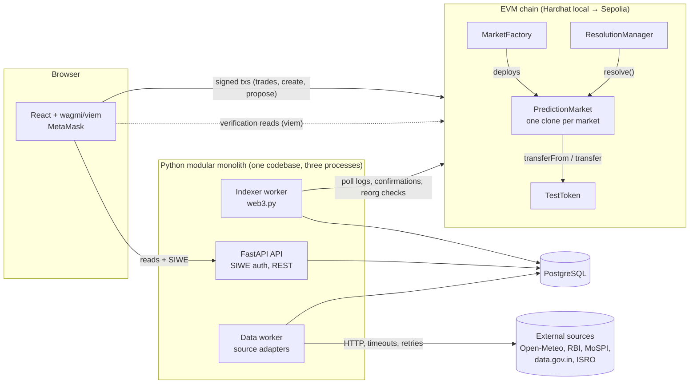
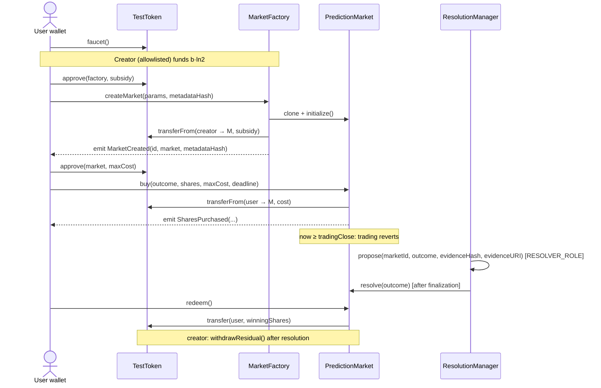
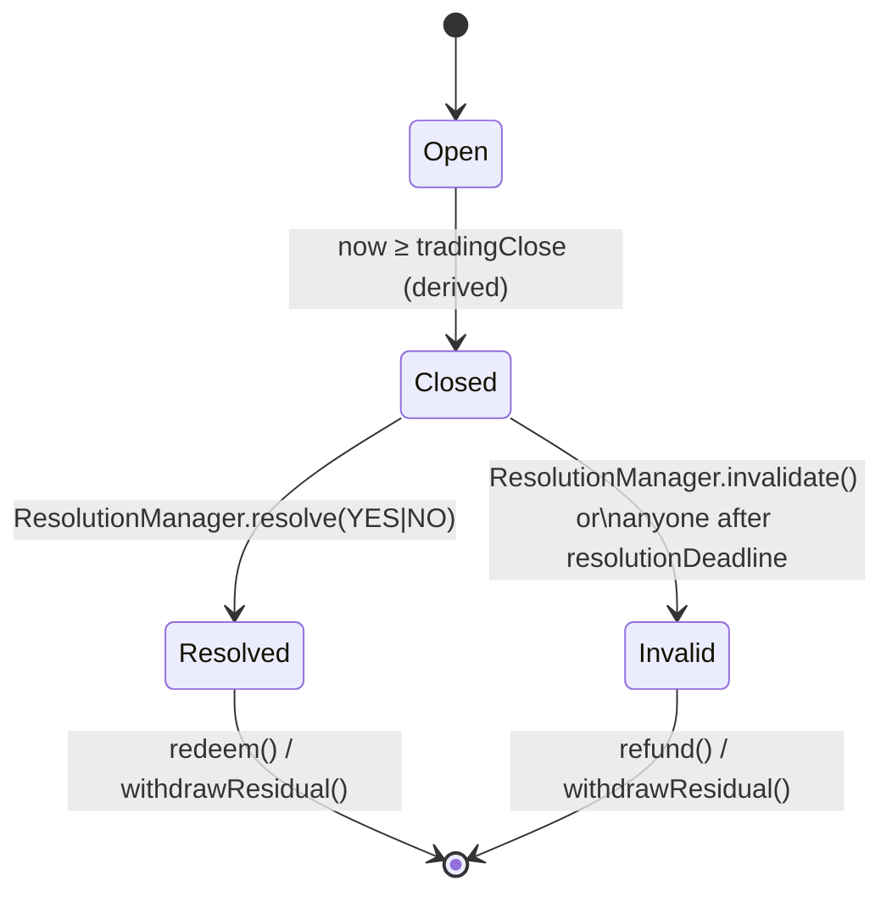
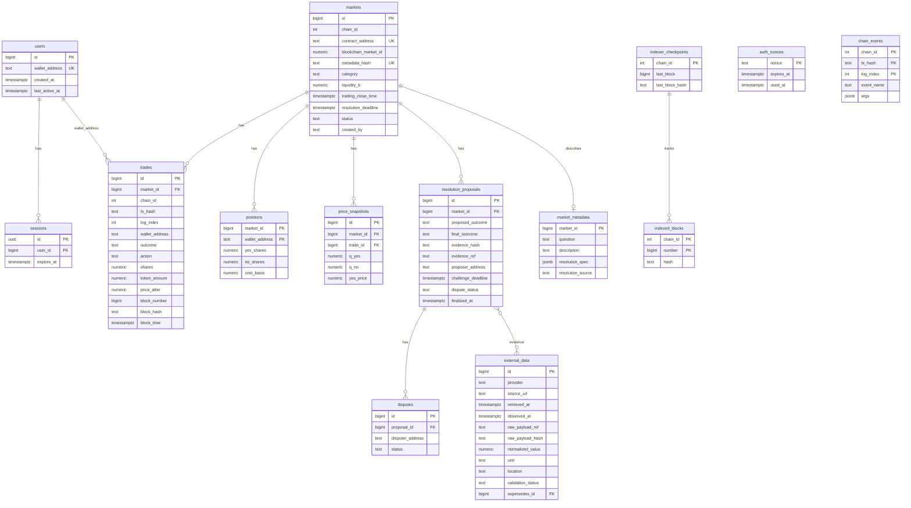

# Architecture — Phase 0

Status: **this is the Phase 0 proposal, kept as the design record.** The system has since been built; where reality differs, trust the README, `docs/implementation-progress.md` and the topic documents (`smart-contracts.md`, `oracle-design.md`, `data-sources.md`, `security.md`, `deployment.md`). Main differences from this proposal: no `data-worker/` directory (workers live in `backend/app/workers`); the treasury is merged into `PredictionMarket`; Hardhat 3's native Solidity tests replaced Foundry; an `Invalid` market state was added; RBI/MoSPI/ISRO/cricket data is entered manually, not crawled; the oracle's Stage 3 is an in-house bonded mechanism with a named arbiter instead of a UMA integration; the brief's `disputes` table is columns on `resolution_proposals`; a `daily_activity` rollup and `external_data`/oracle migrations were added (migrations 0001-0005). The project has no name on purpose (see Phase 8); "the platform" is used throughout.

> **Test-only.** Every token in this system is a simulated test token with no monetary value. Nothing here is legal advice, and nothing here is claimed to be compliant with the Promotion and Regulation of Online Gaming Act, 2025 or its Rules. Legal review is required before any public or commercial use (see §12).

---

## 1. Understanding of the project

A hybrid dApp where users trade YES/NO shares on real-world Indian events using non-monetary test tokens.

- **On-chain (authoritative):** token balances, LMSR pricing, share positions, collateral, resolution state, redemption.
- **Off-chain (convenience, never authoritative):** event indexing into PostgreSQL, market metadata, external-data ingestion, evidence bundles, analytics, read APIs.

Two properties drive most decisions:

1. **The backend must not be able to fabricate a trade or a settlement.** It holds no keys that can move tokens or resolve markets in the MVP. It only reads the chain and stores evidence.
2. **A market is only as good as its resolution criteria.** The hardest problem is not LMSR, it is defining outcomes that a named source can objectively settle, and handling the case where that source is late, wrong, or revised.

The system is *not* fully decentralized. Honest framing: markets are on-chain and trustless to trade; resolution is trusted to a named resolver (Stage 1), then to a bonded-proposer-plus-arbiter model (Stage 3); the frontend, indexer, and API are centralized conveniences.

---

## 2. System architecture



**Process model.** One Python package (`backend/app`) with three entrypoints: `uvicorn app.main:app` (API), `python -m app.workers.indexer`, `python -m app.workers.data_worker`. Same models and config, no duplicated code, no message broker. Workers coordinate through PostgreSQL (checkpoint rows, advisory locks), so a task queue can be added later without redesign.

---

## 3. Repository structure

Deviations from the brief are marked ⚠ and explained in §15.

```
/
├── contracts/                    Hardhat project
│   ├── contracts/
│   │   ├── TestToken.sol
│   │   ├── MarketFactory.sol
│   │   ├── PredictionMarket.sol  (includes collateral accounting)
│   │   ├── ResolutionManager.sol
│   │   └── lib/LMSRMath.sol
│   ├── test/                     unit, fuzz/invariant, gas report
│   ├── reference/lmsr_ref.py     independent high-precision reference (mpmath)
│   ├── scripts/                  deploy, seed-faucet, export-abi
│   └── hardhat.config.ts
├── backend/
│   ├── app/
│   │   ├── main.py
│   │   ├── api/routes/           auth, markets, portfolio, analytics, data, transactions, resolutions
│   │   ├── blockchain/           client, contract_registry, event_listener, event_processor
│   │   ├── data_sources/         base, weather, rbi, mospi, isro, cricket(deferred)
│   │   ├── services/             market, portfolio, analytics, resolution, data_ingestion, pricing
│   │   ├── workers/              indexer.py, data_worker.py        ⚠ replaces top-level data-worker/
│   │   ├── models/ schemas/ database/ core/
│   ├── migrations/               Alembic
│   ├── tests/
│   └── Dockerfile
├── frontend/src/{components,pages,hooks,services,blockchain,charts,types,utils}
├── docs/                         architecture, smart-contracts, api, database, data-sources,
│                                 oracle-design, security, deployment, implementation-progress
├── scripts/                      bench, e2e driver, dev helpers
├── docker-compose.yml  .env.example  .gitignore  README.md
```

---

## 4. Smart contract design

### 4.1 Contracts and responsibilities

| Contract | Role | Key decisions |
|---|---|---|
| `TestToken` | ERC-20 test credit with faucet | **Restricted transfers** (see below). Faucet: fixed amount per address per 24 h, no purchase path, no payment hooks. Name/symbol/NatSpec state "TEST — no monetary value". |
| `MarketFactory` | Creates markets, registry | Deploys EIP-1167 minimal-proxy clones of `PredictionMarket`. `CREATOR_ROLE` allowlist in MVP (anti-spam, anti-ambiguity). Validates params, rejects duplicate `metadataHash`, pulls the funder's subsidy, whitelists the new market on `TestToken`. |
| `PredictionMarket` | Per-market LMSR trading, positions, **collateral/treasury**, redemption | Authoritative for prices, positions, settlement. Only the `ResolutionManager` may call `resolve`/`invalidate`. |
| `ResolutionManager` | Evidence-backed resolution state machine | Global singleton. Stage 1 = role-gated resolver; designed so Stage 3 (bond/challenge/dispute) is additive. |
| `LMSRMath` (library) | Fixed-point cost/price | Wraps a reviewed fixed-point library; no custom `exp`/`ln`. |

### 4.2 Decision: treasury merged into `PredictionMarket`

A separate `MarketTreasury` would hold pooled collateral for all markets, so one accounting bug or exploit drains every market. With collateral held per market clone, the blast radius is one market, the invariant `balance ≥ max(qY, qN)` is checkable locally, and there is one fewer contract and trust boundary. The brief explicitly allows this; I recommend it.

### 4.3 Decision: clones per market, not one singleton

*Singleton (`marketId` → struct)*: simplest indexing (one address), cheapest creation. *Clones*: per-market collateral isolation, simple per-market events, cheap deploy (~45k gas for the proxy). I recommend clones; the indexer discovers markets from `MarketCreated` events and validates every log's emitter against the registry (this satisfies "validate contract address").

### 4.4 Decision: restricted-transfer ERC-20, not non-transferable credits

Market contracts need `transferFrom`/`approve` semantics, and non-standard credits would complicate wallets and tooling. Compromise: standard ERC-20 interface, but `_update` reverts unless one side is the faucet/minting path or a whitelisted market/factory. Result: no peer-to-peer transfers, no DEX listing, no way to "sell" tokens to another person. Whether this is *sufficient* legally is a question for counsel, not something this design settles.

Hardening (added after review):
- **Hard supply cap** and a **per-address faucet cooldown**; the minter role is renounceable after deployment. The faucet can still be sybil-farmed; that is accepted because the tokens are valueless, and documented.
- **Implicit allowance for registered markets:** markets registered by the factory may pull tokens without a per-market `approve`. This is non-standard but safe because the token is non-transferable to arbitrary parties and valueless; it removes one transaction per market. It is documented in the contract NatSpec.
- The factory deploys *and initializes* each clone in one transaction; the implementation contract locks its own initializer. No admin or pause function can move funds. A market's creator cannot hold the resolver role for that market.

### 4.5 Interaction



### 4.6 Market lifecycle



Closure is *derived from the timestamp* (trading reverts when `block.timestamp ≥ tradingClose`); a permissionless `closeMarket()` exists only to emit `MarketClosed` for the indexer.

### 4.7 Deliberate addition: `Invalid` outcome

The brief specifies binary outcomes, but also says missing data leaves a market "unresolved until a fallback is completed". Without a terminal fallback, a source that never publishes locks collateral forever. `Invalid` is a third *terminal market state* (not a tradable outcome).

**Refund rule (corrected after review).** Each user's net cost basis is `Σ buys − Σ sells`, which can be negative for someone who sold at a profit. Refund = `max(0, basis_i) × min(1, available ÷ Σ max(0, basis_j))`, where `available` is the collateral held minus nothing reserved for the funder. This is solvent by construction (the earlier claim that plain cost-basis refunds are "exactly solvent" was wrong when any basis is negative). The funder withdraws whatever remains after all refunds are claimed. A fuzz test covers mixed positive/negative bases. The alternative, paying shares at the frozen final LMSR price, is provably solvent (`q·p ≤ max(q) ≤ C(q)`) but is a mark-to-market payout rather than a void, so it is not the default.

**Triggers.** Only the `ResolutionManager` may void a market early, and it must attach evidence. Anyone may trigger `Invalid` after `resolutionDeadline + INVALID_GRACE` if nothing was finalized (liveness guarantee); the grace period stops a merely-late resolver from voiding the market.

### 4.8 Positions

Held in internal mappings (`yesShares[user]`, `noShares[user]`, `costBasis[user]`), not ERC-1155/ERC-20 outcome tokens. This keeps shares non-transferable (consistent with §4.4) and avoids extra surface. Trade-off: no secondary composability. Acceptable for this scope.

---

## 5. LMSR implementation strategy

### 5.1 Math

With `qY, qN` outstanding shares and liquidity `b`:

- Cost: `C(q) = b·ln(e^{qY/b} + e^{qN/b})`
- Price: `P(Y) = e^{qY/b} / (e^{qY/b}+e^{qN/b}) = 1 / (1 + e^{-(qY-qN)/b})` (logistic of the difference)
- Cost of buying `Δ` YES: `C(qY+Δ, qN) − C(qY, qN)`
- Max subsidiser loss: `b·ln2`

### 5.2 Overflow-safe form (log-sum-exp)

Never compute `e^{q/b}` directly. With `m = max(qY,qN)` and `d = |qY−qN|`:

```
C = m + b · ln(1 + e^{−d/b})
```

The exponent is always ≤ 0, so `exp` stays in (0, 1] and cannot overflow. `ln(1+x)` with `x ∈ (0,1]` is well-conditioned.

### 5.3 Fixed point

- All shares, tokens, and `b` use **1e18 scaling (WAD)**; 1 share redeems exactly 1e18 token-wei.
- Use a reviewed library's signed 59.18 `exp`/`ln` (PRBMath `SD59x18` is the leading candidate; ABDK is the alternative). **I will confirm current versions, licence, and measured gas/accuracy in a Phase 1 spike before committing.** I have not benchmarked either yet.
- **Rounding direction always favours the market**: buy cost rounds up, sell proceeds round down, plus an explicit safety margin of a few wei on the computed cost to cover the library's approximation error. Cost is never taken as the difference of two independently rounded unchecked values without that margin.

### 5.4 Bounds (initial values, to be tuned in Phase 1)

- `b ∈ [10, 100_000]` tokens (so subsidy `b·ln2` is bounded).
- `|qY − qN| / b ≤ 20` enforced on every trade → price stays within ~2e-9 of 0/1, far above fixed-point noise. Trades that would exceed it revert.
- Max shares per trade ≤ a fraction of `b`.

### 5.5 Trading interface

`buy(outcome, shares, maxCost, deadline)` and `sell(outcome, shares, minProceeds, deadline)`. The contract takes an exact **share** amount and enforces a slippage bound. The "enter a token amount" UX is served by the inverse, which has a closed form in the binary case (`Δ = b·ln(e^{(C+s)/b} − e^{qN/b}) − qY`), computed in the **frontend/backend only as an indicative quote**; the contract then re-prices the resulting share count and reverts if cost exceeds `maxCost`. `quoteBuy/quoteSell/price` view functions expose the authoritative numbers.

### 5.6 Solvency invariant

`collateral = b·ln2 (ceil) + Σ buy costs − Σ sell proceeds ≥ C(q) ≥ max(qY, qN)`.

So at resolution the contract can always pay every winning share 1 token, and the creator's residual is `collateral − winningSharesOutstanding ≥ 0`. This is tested as a fuzz invariant after every operation, with the margin from §5.3 as the thing the invariant actually exercises.

### 5.7 Verification

- `contracts/reference/lmsr_ref.py` — independent implementation with `mpmath` (50-digit precision), generating test vectors consumed by Hardhat tests (tolerance asserted explicitly, in wei).
- A TypeScript implementation in the frontend used for quotes; cross-checked against the same vectors.
- Hardhat/Foundry-style fuzz + invariant tests: random trade sequences, repeated buy/sell round trips (the user must never profit from rounding), extreme probabilities, `b` extremes, zero/huge trades.

---

## 6. Oracle and resolution design

### 6.1 Stages and trust assumptions

| Stage | Who decides | Trust assumption | In MVP? |
|---|---|---|---|
| 1. Admin + evidence | A `RESOLVER_ROLE` account submits outcome + `evidenceHash` + `evidenceURI` | You trust the resolver key to read the named source honestly. Evidence makes dishonesty **auditable after the fact**, not impossible. | **Yes** |
| 2. Data-backed proposals | Data worker *drafts* a proposal from an adapter; a human resolver signs and submits | Same as Stage 1 plus trust in the adapter's parsing. The worker holds **no key**. | Yes (drafts only) |
| 3. Optimistic | Anyone proposes with a test-token bond; challenge window; undisputed → final; disputed → arbiter | Honest-challenger assumption within the window; disputes ultimately go to a **named arbiter (centralized)**. It is not a decentralized oracle and will be documented as such. | Phase 5 |

### 6.2 State machine (designed up front so Stage 3 is additive)

`None → Proposed → (Finalized | Disputed → Finalized)`. Stage 1 sets the challenge window to a configurable value (default 0 for local dev, nonzero on Sepolia) so the window logic is exercised from the start.

### 6.3 Evidence bundle

Off-chain JSON stored by the backend, its **keccak/sha256 hash stored on-chain**: market ID, proposed outcome, source name + URL, retrieval time, observation period, raw payload reference + hash, normalized value + units, extraction/transform description, resolver address, challenge deadline. Anyone can recompute the hash from the stored bundle. The backend's `POST /resolutions/{id}/propose` therefore **builds and stores the bundle and returns the hash**; the resolver's wallet submits the transaction. No endpoint can bypass contract authorization.

### 6.4 Rules

- Every market's `metadata` must name the exact source, dataset/station, unit, revision policy (first vs final publication), and missing-data fallback. The create-market form refuses markets without these.
- No LLM or keyword match determines outcomes. An LLM may at most assist in *extracting* a value from a document for a human to confirm.
- UMA: the brief asks me to study UMA's optimistic oracle first. I have **not** done so yet; Phase 5 begins with that review, and I'll then decide between an in-house minimal version and integration. I'm not committing to UMA integration now.

---

## 7. Database design

PostgreSQL, SQLAlchemy 2, Alembic. Rules: UTC `timestamptz` everywhere; on-chain quantities as `NUMERIC(78,0)` (uint256 wei, never float); event tables unique on `(chain_id, tx_hash, log_index)`.



Notes:
- `chain_events` stores every decoded raw event (idempotent); `trades`/`positions` are derived read models and can be **rebuilt by replay**. `price_snapshots` hold actual `(qYes,qNo)` after each trade, the only source for probability charts.
- `external_data` is append-only; a revised value creates a new row with `supersedes_id`, preserving the original.
- `transactions` status is derived from `chain_events` + confirmations, not a separate source of truth.

---

## 8. Backend API architecture

Layering: `routes` (validation, auth) → `services` (logic) → `models`/`blockchain`. Routes never touch web3 write paths.

- **Auth:** SIWE (EIP-4361) via a maintained library: `GET /auth/nonce` (random, 5-min TTL, single-use), `POST /auth/verify` (check signature, domain, chain ID, nonce, expiry, issued-at; mark nonce used) → short-lived session in an `HttpOnly; Secure; SameSite` cookie (bearer fallback for scripts). Reads are public; auth gates metadata creation and resolver/admin endpoints.
- **Surface:** exactly the endpoints listed in the brief, with Pydantic response models, pagination (cursor or limit/offset), filtering/sorting on `/markets`, rate limiting (`slowapi`), explicit CORS allowlist, request timeouts.
- **Write paths that exist:** `POST /markets` (stores metadata, returns `metadataHash` for the wallet to submit to the factory; the indexer later links by hash), `POST /resolutions/.../propose` (stores bundle, returns hash). **Disputes** endpoint only appears in Phase 5.
- **Indexer:** polling `eth_getLogs` over `[checkpoint+1, head − confirmations]` in bounded batches; confirmations 0–1 on Hardhat, ~12 on Sepolia. Stores `(number, hash)` for recent blocks; if a parent hash mismatches, roll back derived rows past the fork point and replay. Idempotent via unique keys and `ON CONFLICT DO NOTHING`. A periodic reconciliation job compares `positions` and market state to on-chain reads and logs/alerts on drift. WebSockets are not relied on.
- **Trades are "pending" until confirmed**; the UI shows the status; analytics count only confirmed rows.
- **Scheduling:** the data worker uses APScheduler *inside the worker process only* (not the API process), with a Postgres advisory lock so a second instance cannot double-run.

---

## 9. Frontend page architecture

React 18 + TypeScript + Vite + Tailwind + Recharts + wagmi/viem. TanStack Query for server state.

| Route | Content | Data |
|---|---|---|
| `/` Dashboard | active/closing/resolved markets, activity, volume, recent trades, source status. Empty states when there are no trades. | API |
| `/markets` | search, category/status filters, sort | API |
| `/markets/:id` | price chart (from `price_snapshots`), trading panel, criteria, source, evidence, recent trades. Panel shows **indicative** quote (TS LMSR) vs on-chain `quoteBuy` re-read before signing. | API + chain |
| `/create` | creator-only form; blocks ambiguous/under-specified markets | API + chain |
| `/portfolio/:address` | positions, indicative value, redeemable, history | API (+ chain verify) |
| `/transactions` | status, block, explorer link | API |
| `/analytics` | indexed-record metrics only | API |
| `/data` | Data Explorer with provenance, freshness, validation | API |
| `/admin` | resolver-gated: markets awaiting resolution, evidence, proposals | API + chain |

Cross-cutting: persistent test-token/legal banner, chain-ID guard with switch-network prompt, duplicate-submit protection, human-readable revert messages, no private-key handling. **Price display uses "tokens", never ₹/INR** (the brief's `₹0.65` example is deliberately not reproduced, since a rupee sign implies monetary value).

---

## 10. Real-world data integration strategy

Honest status: I have **not yet verified** the current availability, terms of use, or machine-readable access for any of these sources. Phase 3 begins with a per-source spike (access method, licence/ToS, rate limits, sample payload) before any adapter is written.

Adapter contract (`data_sources/base.py`): `fetch() → RawRecord`, `normalize() → NormalizedRecord`, `validate()`; the ingestion service stores provenance fields from §6.2 of the brief, retries with backoff, enforces timeouts/rate limits, detects duplicates by `raw_payload_hash`, and never falls back silently to a different provider.

| Category | Planned source | Realistic assessment |
|---|---|---|
| Weather | Open-Meteo | Programmatic and easy, **but its historical data is reanalysis, not IMD station observations.** MVP weather markets must therefore say "resolved using Open-Meteo, dataset X, at lat/lon Y" and must not promise IMD. Each market pins the exact endpoint, model/dataset, coordinates, and variable. Reanalysis lags and can be revised (preliminary vs final versions; to confirm in the spike), so the revision policy must name the authoritative version and resolution waits that long after the period ends. IMD-resolved markets are deferred unless a permitted programmatic source is confirmed. Attribution/licence terms to be reviewed. |
| RBI / economy | RBI publications, MoSPI releases, data.gov.in | Often PDFs/HTML press releases, not stable APIs; scraping may conflict with terms. MVP: adapter fetches and hashes the official document, extracts the value, and a **human confirms** it. data.gov.in has an API where datasets exist (key required). |
| ISRO | isro.gov.in announcements | No structured feed expected. Same pattern: URL + archived snapshot hash + human-confirmed milestone. |
| Cricket | BCCI / ESPNcricinfo | Scraping likely violates terms; no licensed free source identified. **Automated ingestion deferred.** Cricket markets are still supported via the ISRO pattern: a human-confirmed result with the official scorecard URL and a hash of an archived snapshot. No invented results. |

MVP end-to-end uses weather (the only fully automatable source) and economy markets with human-confirmed evidence.

---

## 11. Testing strategy

| Layer | Tooling | Focus |
|---|---|---|
| Contracts | Hardhat tests; fuzz/invariant tests; Slither | Lifecycle, LMSR vs `mpmath` vectors, solvency invariant, rounding round-trips, access control, reentrancy, double redeem, `Invalid` refunds |
| Backend | pytest, testcontainers/Postgres | SIWE (replay, expiry, wrong domain/chain), API validation/pagination, adapters with recorded fixtures (unit only), indexer idempotency, restart recovery, simulated reorg |
| Data | pytest | Missing/invalid/revised values; live-API smoke tests marked and **excluded from the default run** to keep CI deterministic |
| Frontend | Vitest + Testing Library; Playwright with a mocked injected wallet | Quote maths vs shared vectors, network mismatch, empty states, tx failure paths, responsive layout |
| E2E | Script driving Docker Compose | The 19-step lifecycle from the brief, no manual DB edits |
| Perf | `scripts/bench` | Gas per operation (Hardhat gas reporter), API latency, indexing lag, ingestion time; results recorded only after being measured |

---

## 12. Security and legal considerations

**Legal (not advice).** The design avoids the features the brief lists: no deposits, fees, prizes, payment integration, cash-out, or token purchase; restricted-transfer test token; disclaimers in UI/README/contract NatSpec; testnet/local only; no mainnet deployment. **I have not read the Act or the 2026 Rules in this session**, so I make no claim about how they apply to a free, valueless-token simulation of event-outcome trading. A qualified lawyer must review before any public deployment, and the README will say so.

**Contracts.** CEI ordering, `ReentrancyGuard` on state-changing market functions, `SafeERC20`, role-based access (OpenZeppelin `AccessControl`), deadline + slippage guards, bounded `b` and trade size, Solidity ≥0.8 checked arithmetic with explicit handling inside the math library, Slither with any suppression documented.

**Backend.** Secrets in env only; ORM parameterization; nonce/session expiry; rate limits; strict CORS; no secret logging; DB backup procedure documented.

**Frontend.** Address and chain-ID validation, confirm-before-sign, no key material anywhere.

**Specific risks accepted in MVP (will be documented):** a single resolver key is a trusted party; the faucet can be sybil-farmed (acceptable for valueless tokens); markets are creator-allowlisted.

---

## 13. Timeline (realistic, solo, ~15–20 h/week)

| Phase | Scope | Estimate |
|---|---|---|
| 1 | Contracts + LMSR + tests | 3–4 weeks (LMSR numerics is the long pole) |
| 2 | Backend, DB, SIWE, indexer | 3–4 weeks |
| 3 | Data adapters, provenance | 2–3 weeks (dominated by source spikes) |
| 4 | Frontend | 4–5 weeks |
| 5 | Oracle stages 2–3 | 2–3 weeks |
| 6 | Integration, Slither, perf | 2 weeks |
| 7 | Docker, optional Sepolia | 1–2 weeks |
| 8 | Review, docs, naming | 1 week |
| | **Total** | **~18–24 weeks part-time**, roughly 8–10 weeks full-time |

These are planning estimates, not measurements.

---

## 14. Risks and mitigations

| # | Risk | Likelihood / impact | Mitigation |
|---|---|---|---|
| 1 | LMSR fixed-point error breaks solvency | Med / **High** | log-sum-exp form, bounded `|d|/b`, market-favouring rounding + margin, `mpmath` vectors, solvency fuzz invariant |
| 2 | Ambiguous or unresolvable markets | **High** / High | Structured resolution spec required at creation, creator allowlist, `Invalid` refund path, resolution-deadline escape hatch |
| 3 | Resolver key compromise / dishonesty | Med / High | Evidence hashing for auditability, multisig-or-separate key on Sepolia, honest trust documentation, Stage 3 later |
| 4 | Source unavailable, revised, or ToS-restricted | **High** / Med | Per-source spike first, append-only revisions, no silent fallback, human-confirmed evidence, defer cricket |
| 5 | Reorgs / RPC flakiness corrupt read model | Med / Med | Confirmations, block-hash tracking, rollback+replay, derived tables rebuildable, reconciliation job |
| 6 | Regulatory misinterpretation | Unknown / **High** | Test-only design, restricted token, disclaimers, explicit "legal review required", no public launch |
| 7 | Toolchain mismatch on this machine | **Observed** | Local Node is v24 and Python is 3.14, both newer than most Hardhat/web3.py/SQLAlchemy toolchains are tested against. Plan: run backend/contracts in Docker with pinned Node 22 LTS and Python 3.12, and pin versions after Phase 1 verification |
| 7b | Repo lives inside OneDrive | **Observed** / Med | OneDrive syncing `node_modules` and Docker bind mounts is slow and can hit file locks. Recommendation: move the repo outside OneDrive; until then, keep `node_modules` in Docker named volumes |
| 8 | Scope creep | High / Med | MVP cut below; phase gates; no new infra without a concrete need |
| 9 | Gas cost of on-chain `exp/ln` | Med / Low | Measure in the Phase 1 spike; Sepolia/local only, so cost is tolerable |

---

## 15. Review: complexity and weaknesses found, and changes from the brief

1. **Treasury merged into `PredictionMarket`**: smaller attack surface (§4.2).
2. **Clone-per-market** instead of one monolith or pooled vault (§4.3).
3. **`data-worker/` folded into `backend/app/workers`** ⚠: a separate top-level package would duplicate models/config; separate *processes* are kept, separate *codebases* are not.
4. **`Invalid` terminal state added** ⚠ (§4.7): needed for the brief's missing-data requirement to be safe.
5. **Backend holds no signing keys**: propose/create endpoints return hashes; wallets sign. This is stricter than the brief's "backend creates a resolution proposal" and removes a trust point.
6. **Sell support included in MVP**: LMSR makes it nearly free once buys work, but it doubles rounding-edge tests. Kept because the brief lists portfolio P&L.
7. **UMA integration deferred**, in-house bond/challenge/arbiter model preferred unless the Phase 5 review says otherwise.
8. **No Redis/Celery/Kubernetes/second chain.** APScheduler in the worker plus Postgres locks suffice.
9. **"₹" removed from price display** for legal-signal reasons.
10. **Cricket deferred**: no verified permitted source.
11. **Weakness acknowledged:** with a single resolver, this is a *trusted-resolution* market; claims in the README must say so.

---

## 16. MVP vs advanced

**MVP (must work end-to-end):** TestToken + faucet; factory/clones; LMSR buy/sell; derived closure; Stage 1 evidence-backed resolution; `Invalid` refund; redemption; indexer with confirmations + replay; SIWE; core REST API; weather (Open-Meteo) and one economy source; dashboard, explore, market detail + trading, create, portfolio, transactions, data explorer, admin resolution; Docker Compose; the 19-step E2E test; Slither run; measured gas/latency.

**Advanced (after MVP):** Stage 2 draft-proposal automation; Stage 3 optimistic oracle with disputes; multi-source economy/ISRO adapters; analytics depth (category/outcome breakdowns); Sepolia deployment + hosting; reorg stress tests; cricket (if a permitted source exists); IMD-station resolution; multisig resolver.

---

## 17. Decisions I need from you

Defaults apply if you don't object:

1. **Treasury merged + clone-per-market** (§4.2–4.3), default: yes.
2. **Restricted-transfer ERC-20** (§4.4), default: yes.
3. **`Invalid` refund state** (§4.7), default: yes.
4. **Weather markets resolve via Open-Meteo, not IMD**, default: yes.
5. **Cricket deferred**, default: yes.
6. **Toolchain in Docker with Node 22 / Python 3.12** instead of your local Node 24 / Python 3.14, default: yes.
7. Hardhat vs Foundry: **resolved in the Phase 1 spike.** Hardhat 3.21.2 runs Foundry-style Solidity fuzz and invariant tests natively (`forge-std` as an npm dependency), so Foundry is **not** needed. Hardhat TS (Mocha) covers lifecycle/integration tests; `test/Solvency.t.sol` covers fuzz/invariants.

### Resolved decisions (approved with the revisions above)

All seven were approved with these revisions: cricket supported via human-confirmed evidence; Invalid refund formula corrected (§4.7); token hardening (§4.4); Foundry for invariants; repo-location recommendation (risk 7b). Additional improvements adopted: trade events carry post-trade `qYes`/`qNo` so the indexer needs no state reads; frontend ABIs/types generated from compiled contracts; frontend finds shares-for-token-amount by searching the on-chain `quoteBuy` view (TS LMSR is indicative only); event schema is versioned; Slither and tests run in Docker from day one; demo mode and fixtures are visibly labelled and excluded from the default run.

**Project rule: Claude never runs git add/commit/push. The owner makes all commits.**
