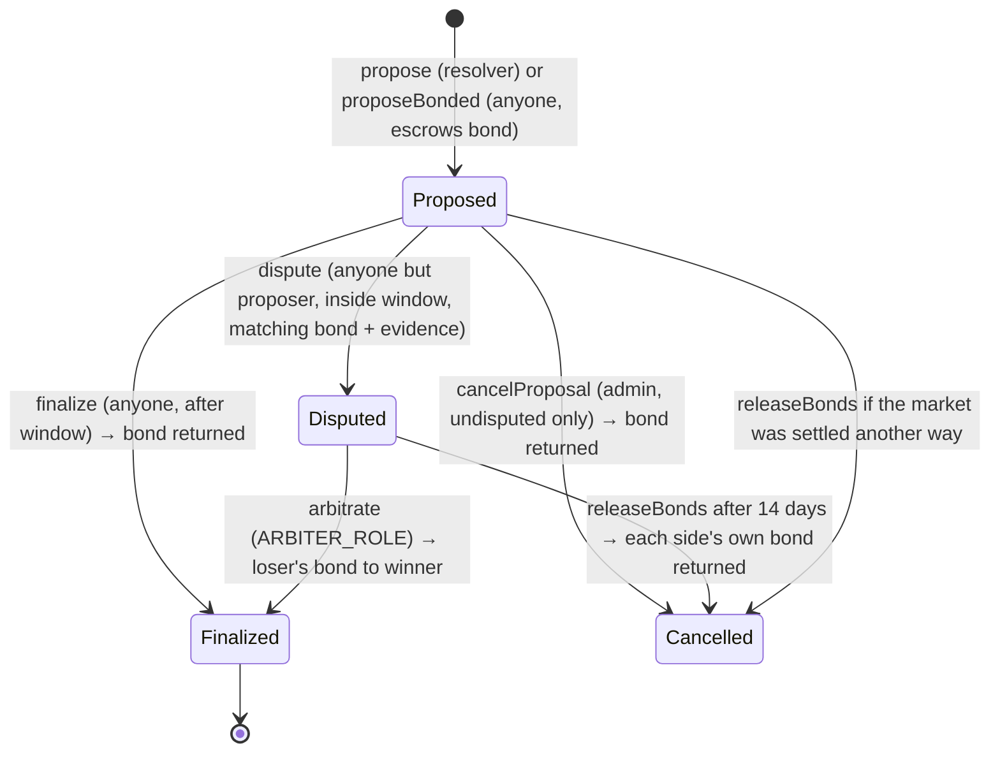

# Oracle and resolution design (Phase 5, as implemented)

TEST-ONLY. Bonds are test tokens with no monetary value. **This is not a decentralized oracle.** It is a bonded, challengeable, evidence-backed process whose final authority, when contested, is one named arbiter account.

## 1. Trust assumptions, stage by stage

| Stage | Who proposes | Bond | Who can contest | Who decides if contested | What you must trust |
|---|---|---|---|---|---|
| 1. Admin + evidence | `RESOLVER_ROLE` account | none | nobody if `challengeWindow == 0` (dev mode); anyone if the window is non-zero | the arbiter | the resolver's honesty (evidence makes dishonesty *auditable afterwards*, not impossible) |
| 2. Data-backed drafts | the same resolver, after the data worker drafts an outcome from Open-Meteo | none | as above | as above | the resolver **and** the adapter's parsing; the worker holds no key and submits nothing |
| 3. Optimistic (bonded) | **anyone** | `bondAmount` test tokens | anyone but the proposer, with a matching bond | the arbiter (`ARBITER_ROLE`) | at least one honest watcher during the window, **and** the arbiter |

Also trusted in every stage: `DEFAULT_ADMIN_ROLE` (manages roles and parameters; may cancel an *undisputed* proposal), the oracle contracts' correctness (not audited), and, for weather, Open-Meteo's reanalysis model (not station observations). The market creator can never resolve, propose for, or arbitrate their own market.

What the bond does and does not do: it makes careless or frivolous assertions cost something and it pays a successful challenger. It does **not** make the final ruling trustless, an **undisputed false proposal is accepted**, and in this test environment bonds are cheap by construction (the faucet gives every address 1,000 tokens a day), so they are a demonstration of the mechanism, not a security guarantee.

## 2. Mechanism

* **Proposal:** market must be past `tradingClose` and `Active`; evidence hash required (the bundle lives off-chain, the URI is in the event). Window = `challengeWindow` (resolver path, may be 0) or `bondedChallengeWindow` (bonded path, must be > 0, ≤ 7 days).
* **Dispute:** one per proposal, strictly before the deadline, bond = the amount **snapshotted at proposal time** (the admin changing parameters cannot move the goalposts mid-flight), disputer's own evidence hash required.
* **Arbitration:** only `ARBITER_ROLE`; an arbiter may not be the proposer, the disputer or the market's creator; a rationale hash is required. The arbiter's verdict (YES / NO / INVALID) is applied to the market and may differ from both parties' claims. `proposerWon = (verdict == proposed verdict)`. **The loser's bond goes to the winner; the winner's own bond is returned.** For an unbonded resolver proposal, a successful resolver wins the disputer's bond; an overturned resolver loses nothing.
* **Liveness:** a dispute the arbiter never decides can be unwound by anyone after `ARBITER_TIMEOUT` (14 days), returning each side's own bond; escrow is also released if the market was settled some other way (e.g. voided by `invalidateExpired`). A market nobody resolves is still voided at `resolutionDeadline + 7 days`.
* **Accounting invariant (tested):** `totalLockedBonds == token.balanceOf(ResolutionManager)` after every path, and total token supply is conserved across randomized paths.
* **Token wiring:** the ResolutionManager is a privileged spender of the test token (like the factory), so bonding needs no `approve`; test tokens still cannot move between people.

Parameters (local deployment defaults, overridable with env vars in `deploy.ts`): bond 100 tokens (bounds 1 to 10,000), bonded window 600 s, resolver window 0, arbiter = Hardhat account #6.

## 3. Evidence trail

Every document is canonical JSON whose keccak256 is stored on-chain: the proposer's evidence (`kind: proposal`), the challenger's (`kind: dispute`, which references the proposal's hash) and the arbiter's reasoning (`kind: arbitration`, which references both). The API serves each by hash (`keccak256(body) == hash`) and `/markets/{id}/evidence` lists them with `hash_verified`. The backend stores documents and returns hashes; **only the user's wallet can propose, dispute or decide.**

## 4. UMA review (required by the brief) and decision

What I could verify from the documentation I could actually read (docs.uma.xyz, 2026-11-05):

* UMA's optimistic oracle: a proposer posts a bond; a challenge period (liveness) follows; an undisputed proposal settles and the proposer gets the bond (and any reward) back; one dispute per proposal, with a dispute bond; a correct dispute earns a share of the forfeited proposer bond.
* A dispute escalates to the **DVM**: UMA stakers vote in rounds with a 24 h commit and 24 h reveal period (a dispute must be at least 4 h old to enter a round); it resolves when at least 65 % of staked UMA agrees; non-voters and minority voters are slashed.
* The OOv3 quick start I could open targeted Görli (no longer a live network) and its example used no asserter bond; its default liveness is 120 s.

What I could **not** verify from the pages I could read: OOv3's bond-currency requirements and minimum bond, whether OOv3 is deployed on Sepolia, and the exact bond-distribution rules. The statement that UMA requires a whitelisted bond currency is from my background knowledge, not from those pages.

**Decision: do not integrate UMA; build an in-house, UMA-inspired mechanism with a named arbiter.** Reasons: (1) UMA's final authority is a token-holder vote over days, which cannot exist on a local chain and cannot be demonstrated honestly on a test network; (2) using it for real would mean bonding in a real, whitelisted currency, which the project's no-money rule forbids; (3) I could not confirm a usable testnet deployment. The cost of this choice is explicit: our final authority is one account, where UMA's is an economic vote. **How to replace it later:** `ResolutionManager` already isolates the interface the markets use (`resolve` / `invalidate`, called only by it). A UMA adapter would call OOv3 `assertTruth` instead of `proposeBonded`, implement the assertion-resolved callback to call `resolve`/`invalidate`, and drop `arbitrate`; the evidence format, API and UI would carry over.

## 5. Known weaknesses

| Weakness | Consequence | Status |
|---|---|---|
| Single arbiter | A corrupt or compromised arbiter decides any dispute | accepted, documented; no appeals |
| Undisputed false result accepted | Needs a watching challenger; none is built or alerted | accepted; no automated watcher |
| Cheap bonds in a faucet world | Griefing/sybil are cheap | inherent to valueless tokens |
| Dispute delays a result | A disputer can force a wait up to 14 days at the cost of a bond | liveness timeout bounds it |
| Resolver proposals with window 0 cannot be disputed | Dev-mode shortcut | use a non-zero window anywhere that matters |
| Arbiter collusion with a non-party | Not detectable on-chain | accepted |
| Not audited | | Slither and review in Phase 6 |

## 6. What the tests cover

Contracts (`oracle.test.ts`, 21 tests): bonded proposals (no approval step, escrow, refusals), undisputed finalization and bond return, admin cancel with refund, dispute rules (window, self, one per proposal, snapshot bond), arbitration both ways and INVALID with exact payouts, unbonded resolver disputes, access control, arbiter conflicts, timeout unwind, release when settled elsewhere, parameter validation, conservation over randomized paths; gas (single runs): `proposeBonded` 233,343, `dispute` 109,361, `arbitrate` 125,095, bonded `finalize` 113,795. A mutation check (paying the proposer regardless of ruling; not reducing escrow) made 2 and 3 tests fail. Backend (`test_oracle_flow.py`, 8 tests) drives all of it through the API, SIWE sessions, the indexer and PostgreSQL, including `reconcile`. Frontend: 14 component tests for the challenge/arbiter panel and bonded proposing. The full flow was also run by hand in a browser with three wallets (see `implementation-progress.md`).
